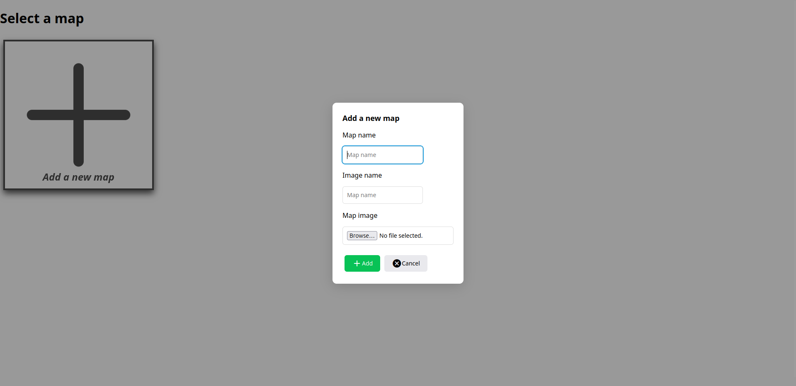
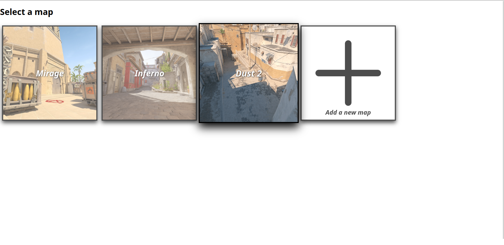
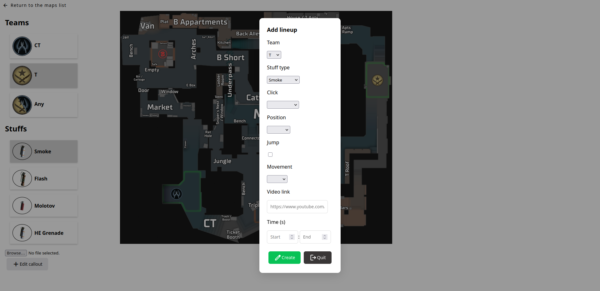
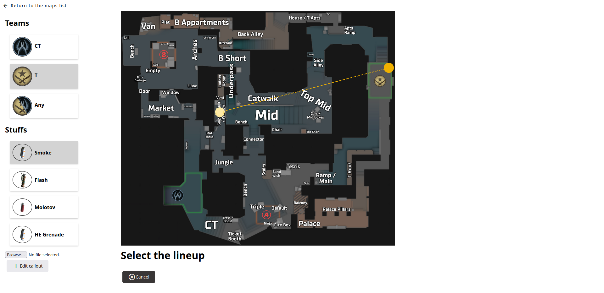
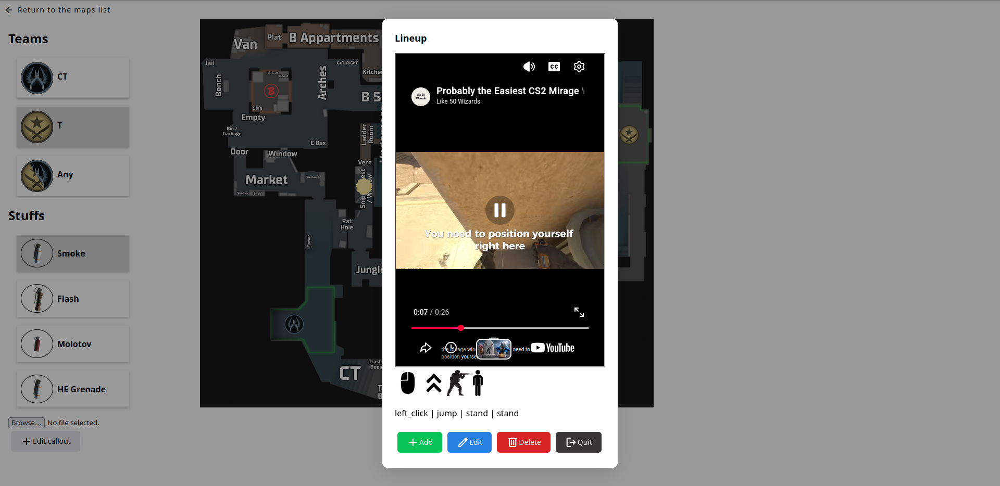

# CS2-Utils

A web-based tool for the video game CS2 which presents interactive maps and allow to save Youtube videos for utilities. You can add the different maps, and add lineups by selecting the type (smoke, flash, ...), the side (T, CT), the positions on the map, and the basic informations (stand, jump, ...) and also a link towards a youtube video to explain the lineup

## Run

`docker compose up`

## Presentation

**Create a new map**

**Select a map**

**Create a new linup**

**Select a lineup**

**Visualize a lineup**

